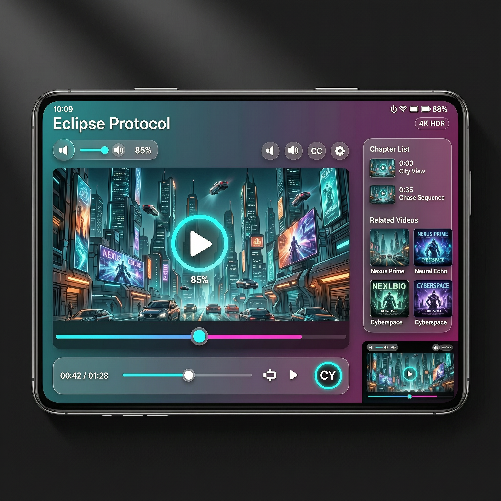

# Kenya-Eye · Eclipse Protocol Player

A **native Android video player** built from the *Eclipse Protocol* design mockup —
Kotlin, Jetpack Compose, Material You (Material 3) and the Media3 / ExoPlayer stack.

<p align="center">
  
</p>

The mockup lives at [`docs/design/eclipse-protocol-player-mockup.png`](docs/design/eclipse-protocol-player-mockup.png).

---

## Feature map (mockup → native implementation)

| Mockup element | Native implementation |
| --- | --- |
| 16:9 cinematic player frame | Media3 `PlayerView` (ExoPlayer) in a clipped, elevation-shadowed Compose box with real playback |
| "Eclipse Protocol" 28px title | `TopBarOverlay` — 28sp title bound to the active media item |
| Glowing play/pause button | `GlowPlayButton` — pulsing radial cyan halo + gradient-ringed circle, drives ExoPlayer |
| 3D arc volume slider (85%) | `VolumeArc` — draggable Canvas dial with bevel, specular highlight, thumb + live % label; sets real `player.volume` |
| Fullscreen · PiP · CC · Settings | Real actions: orientation + immersive fullscreen, `enterPictureInPictureMode()` (auto-PiP on Android 12+), caption track toggle via `TrackSelectionParameters`, quality dialog (Auto/1080p/720p/480p → `setMaxVideoSize`) |
| 1px cyan→magenta gradient progress bar | `GradientProgressTrack` — 1dp razor-thin line (`#00F5FF` → `#FF00AA`), hover hairline, scrubber that grows on hover/drag, tap + drag seeking |
| `00:42 / 01:28` timestamps | Live `positionMs / durationMs` formatted from the real player |
| Glassmorphic 8dp bottom bar | `GlassBottomBar` — 8dp elevation, 24dp rounded corners, gradient hairline border, mini seek bar, Cast, Next-episode, avatar |
| "CY" avatar + pulsing ring | `AvatarCy` — animated infinite-transition neon ring |
| 10:09 · 88% · "4K HDR" pill | **Real** device clock (`SimpleDateFormat`) and battery (`BatteryManager`), quality pill from media metadata |
| Floating PiP mini player | Native Android Picture-in-Picture (16:9 `PictureInPictureParams`) |
| Chapter List (0:00 City View…) | `SidePanel` — right-edge swipe or tap to open; chapters seek the real player, current chapter highlighted |
| Related Videos 3×2 grid | Generated premium posters (`Nexus Prime`, `Neural Echo`, `Cyberspace`, …) that switch the playlist item |
| Material You accent derivation | `dynamicDarkColorScheme` on Android 12+ with the signature cyan/magenta pinned on top |

## Tech stack

- **Kotlin 2.0** · **Jetpack Compose** (BOM 2024.12) · Material 3
- **Media3 / ExoPlayer 1.5** — playlist, audio focus, become-noisy handling
- **Android 16 / API 35** target, minSdk 26 (Picture-in-Picture capable)
- No third-party UI dependencies — every control is hand-drawn Compose/Canvas

## Project structure

```
app/src/main/java/com/kenyaeye/eclipse/
├── MainActivity.kt                  # Edge-to-edge host + real PiP plumbing
├── data/DemoContent.kt              # Playlist, chapters, related videos
├── player/
│   ├── PlayerScreen.kt              # Screen scaffold + playback state/effects
│   ├── Controls.kt                  # Top overlay, glow button, volume arc, dialogs
│   └── Bars.kt                      # Gradient track, glass bottom bar, side panel
└── ui/theme/                        # Material You theme, colors, type
app/src/main/res/
├── drawable-nodpi/                  # Hero still + 3 generated posters
├── mipmap-anydpi-v26/               # Adaptive launcher icon
└── values/                          # Strings, colors, theme
```

## Build & run

1. Open the repository root in **Android Studio** (Hedgehog/Koala or newer, JDK 17 bundled).
2. Let Gradle sync (wrapper `gradle-8.9`, AGP 8.5.2 — no extra SDK setup beyond the standard SDK 35).
3. Run the `app` configuration on any device/emulator with **API 26+** (API 31+ recommended for dynamic color + auto-PiP).

```bash
./gradlew :app:assembleDebug   # CLI build
```

## Demo content

Playback streams the public Google GTV sample bucket (Blender/Google open films) so the
project runs with zero setup. To ship your own catalogue, edit
[`data/DemoContent.kt`](app/src/main/java/com/kenyaeye/eclipse/data/DemoContent.kt) —
each `MediaTrack` is a title + URL + poster resource.

## Roadmap

- [ ] Cast SDK integration (button currently opens a device-scanner dialog)
- [ ] DRM/Widevine + offline downloads
- [ ] `media3-session` background playback with media notification
- [ ] Captions side-loading (WebVTT) UI polish

## License

MIT — see [LICENSE](LICENSE).
